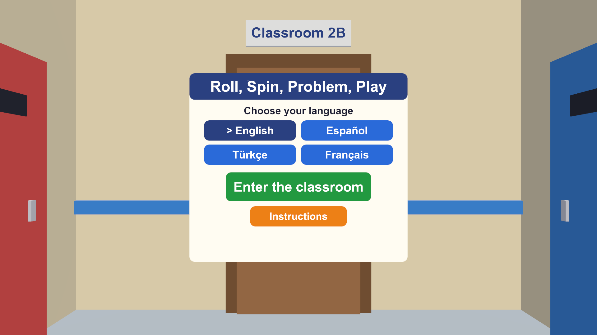
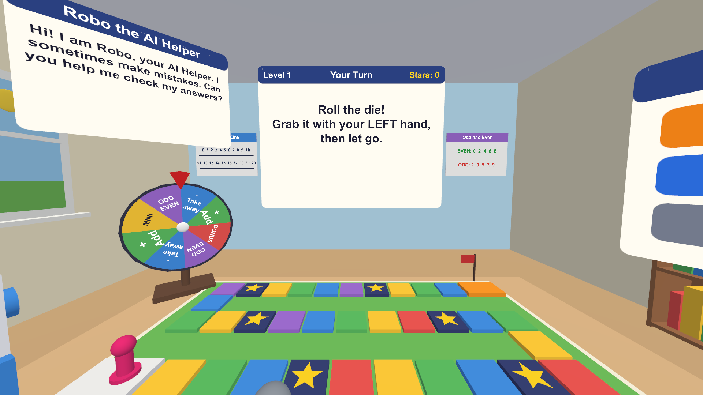
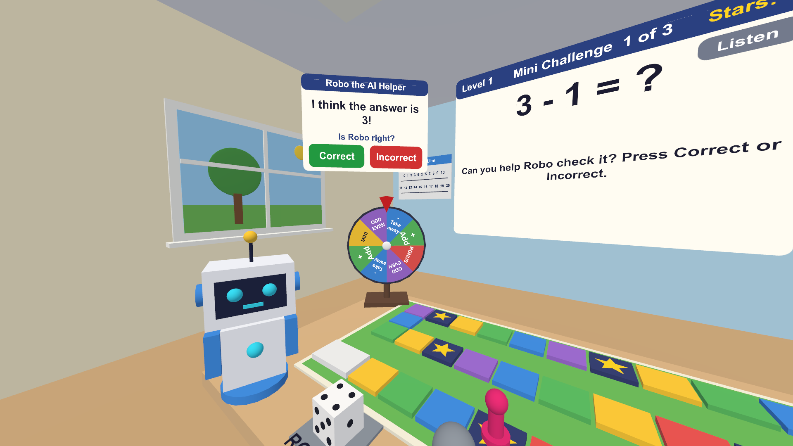
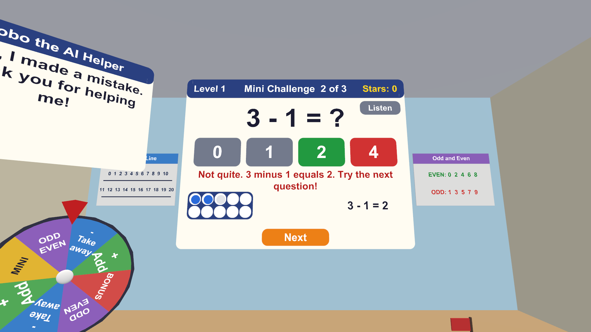
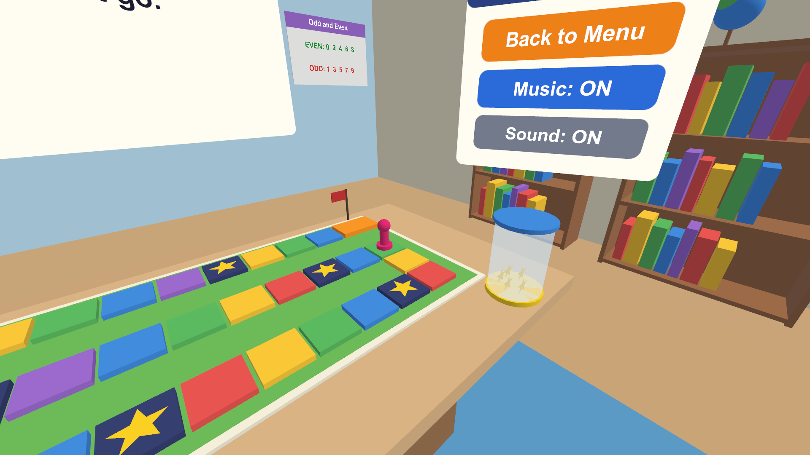
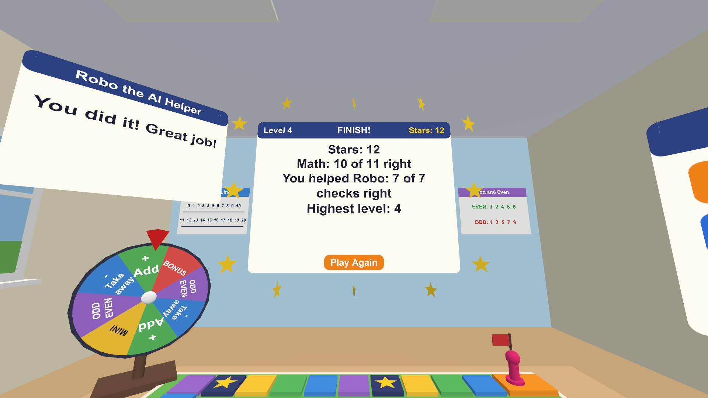

# CSC 461/592 – Final VR Assignment

## Team
Ahmet Nejdet Begdes and Efe Kaan Karaormanli (Group 10)

## Roll, Spin, Problem, Play
A small, single-player educational VR board game for second-grade students, built for Meta Quest 2/3 with Unity.

**Rationale.** The game is the VR version of *Roll, Spin, Problem, Play*, a physical math board game designed by EDN 303 students Hannah Terry and Bailey Clark. Young students practice addition, subtraction and odd/even numbers more willingly when the practice is a game they can touch: in VR they grab and roll a die, pull a handle to spin a wheel, and watch their game piece move. We added three things to the original idea: **adaptive difficulty** (questions get harder or easier with the student's answers), **mini challenges** on star spaces, and a **simulated AI Helper** robot that sometimes suggests a wrong answer on purpose, so students learn that AI tools are useful but must be checked. The player stays in one place (seated or standing) at a table, which keeps the experience comfortable and simple.

## Screenshots

**1. Entrance:** the game starts in the school hallway. The child chooses a language and enters the classroom.



**2. The classroom from the player's seat:** board, die (left hand), SPIN handle and wheel, Robo the AI Helper, and the question panel.



**3. Robo, the simulated AI Helper:** the child touches Robo with the left hand to hear its idea, then decides if Robo is right.



**4. Learning from mistakes:** after a wrong answer the right answer turns green and a ten-frame picture explains it.



**5. Star jar:** every star flies into the jar on the table. The menu (Back to Menu, Music, Sound) is on the right.



**6. FINISH:** the stars fly out of the jar and frame the result panel, with a summary of the game.



*Screenshots were captured in the Unity Editor (desktop view of one eye) with the automatic tour in menu **RSPP → Capture README Screenshots**; the headset shows the same scene in stereo.*

---

# Technical documentation

- **Original game idea (EDN 303):** Hannah Terry and Bailey Clark
- **Engine and SDKs:** Unity 6000.3.22f1 (Built-in Render Pipeline), OpenXR, XR Interaction Toolkit, C#
- **Learning goals:** addition, subtraction, odd/even numbers, and checking an AI helper's suggestion instead of trusting it automatically

> **Status of this version (v0.2).** v0.1 was opened and run by the team; the app started but the headset controllers did not interact. The most likely cause is that XR was never switched on in the project (the app then runs as a flat window). v0.2 adds an automatic XR set-up script and an in-headset status line (section 6). The game rules and turn flow were executed and tested outside Unity (section 11). **v0.2 itself has not been compiled by Unity or run on a headset by its author**, so treat the VR interaction as unconfirmed until you see "Left controller: OK / Right controller: OK" on the welcome screen.

---

## 1. Required Unity version

- **Unity 6000.3.22f1 LTS** (the version required by the course; recorded in `ProjectSettings/ProjectVersion.txt`).
- Install the **Android Build Support** module (with OpenJDK and Android SDK & NDK Tools) in Unity Hub.
- New project template equivalent: 3D **Built-in Render Pipeline**.

## 2. Required packages

They are listed in `Packages/manifest.json` and download automatically the first time the project opens (internet needed once).

| Package | Version |
|---|---|
| XR Interaction Toolkit (`com.unity.xr.interaction.toolkit`) | 3.3.2 |
| OpenXR Plugin (`com.unity.xr.openxr`) | 1.16.1 |
| XR Plug-in Management (`com.unity.xr.management`) | 4.5.4 |
| XR Core Utilities (`com.unity.xr.core-utils`) | 2.5.3 |
| Input System (`com.unity.inputsystem`) | 1.17.0 |
| Unity UI / uGUI (`com.unity.ugui`) | 2.0.0 |

No TextMesh Pro import, no XRI samples, no Meta SDK and no third-party assets are needed. The render pipeline is the **Built-in Render Pipeline**.

## 3. Open the project

1. Unzip. You get the folder `Roll_Spin_Problem_Play_VR_Group10`.
2. Unity Hub → **Add** → **Add project from disk** → choose that folder → open it.
3. If Unity asks about the editor version, pick your installed 6000.3 version.
4. If Unity asks to enable the new Input System backend and restart, choose **Yes**.
5. Wait for the packages to import (the first time takes a few minutes).

## 4. Which scene to open

`Assets/Scenes/MainScene.unity` (it is already the only scene in the build list).

**Important — how the scene works.** In the Hierarchy you will see a single object, **RSPP Game**, with the `GameBootstrap` component. When you press **Play**, that component builds everything from code: XR rig, classroom, table, board, die, wheel, robot and UI. Press Play and look at the Hierarchy to see all the objects.

Why this approach: the project was written without access to the Unity Editor, and a hand-written scene file with hundreds of cross-references and prefab links is the most likely thing to arrive broken. Building from C# means there are no Inspector references or prefabs that can be missing, and every position, size, color and rule can be changed in one file: `Assets/Scripts/Core/GameConfig.cs`. For the same reason there is no `Prefabs` folder.

## 5. Test the gameplay

### A. In the Editor without a headset (fastest)

Open `MainScene`, press **Play**. With no headset detected the game switches to desktop test mode:

| Input | Action |
|---|---|
| Left mouse click | Press UI buttons (replaces the right-hand ray) |
| **Space** | Roll the die (replaces grabbing with the left hand) |
| **Enter** or **S** | Pull the SPIN handle |
| **T** | Touch Robo (replaces reaching into Robo with the left hand) |
| Hold right mouse button + move | Look around (Robo and the wheel are on the left, the menu on the right) |
| **R** | Re-centre the view |

Suggested test run:
1. The game opens in the school hallway. Choose a language (English, Español, Türkçe, Français), try **Instructions**, then click **Enter the classroom** (the screen fades and the classroom appears).
2. Press **Space** → the die tumbles, the token hops the rolled number of spaces.
3. Press **Enter** → the wheel spins and stops on a segment.
4. Click an answer → immediate feedback → click **Next**. A wrong answer shows the ten-frame picture.
5. When the panel says Robo has an idea, press **T**, then click **Correct** or **Incorrect** in Robo's bubble.
6. Answer 2 questions correctly in a row → the header changes to **Level 2**. Answer 2 wrong in a row → one level down.
7. Land on a dark-blue star space (or spin MINI) → mini challenge of 3 questions.
8. Reach **FINISH** → confetti and a summary with **Play Again**. Also try the right-hand menu: **Back to Menu** (asks "Leave the game?"), **Music**, **Sound**.
9. In English, questions and instructions are read aloud; the **Listen** button repeats the question.

### B. In the Editor with a Quest over Link / Air Link

Do the XR setup in section 6 for the **Windows/PC** tab too, start Link, then press Play.

### C. On the headset

Build and run (section 6).

## 6. Configure and build for Meta Quest 2 / 3

### Automatic set-up (new in v0.2)

`Assets/Editor/RSPPQuestSetup.cs` configures the project for Quest the first time it is opened, and again whenever you choose the menu **RSPP → Set Up XR For Meta Quest**. A dialog lists what it did:

- XR Plug-in Management: **OpenXR** ticked for **Android** (headset build) and **PC** (Quest Link in the Editor)
- OpenXR: **Oculus Touch** and **Meta Quest Touch Plus** controller profiles, **Meta Quest Support**
- Player: Input System on, IL2CPP, ARM64, minimum API level 29

If the dialog says the Input System was just enabled, **restart the Unity Editor**.

Then:
1. **RSPP → Set Up XR For Meta Quest** (run it once by hand to see the report).
2. **Edit → Project Settings → XR Plug-in Management**: confirm **OpenXR** is ticked on the Android tab. Open **Project Validation** and press **Fix All** if anything is listed.
3. **File → Build Profiles → Android → Switch Platform**.
4. Headset in developer mode, connected by USB, USB debugging allowed. Pick it under **Run Device** → **Build And Run**.

### Check inside the headset

The welcome screen shows a status line until you press Start Game:

| Status line | Meaning |
|---|---|
| `VR: OpenXR Display   Left controller: OK   Right controller: OK` | Everything is set up. |
| `Left/Right controller: NOT FOUND` | Pick the controllers up. If it stays, the controller profile is missing: run the RSPP menu and rebuild. |
| `SETUP PROBLEM: VR is not active in this build` | The app is running as a flat window: OpenXR is not ticked for Android. Run the RSPP menu and rebuild. |
| `SETUP PROBLEM: the Input System is switched off` | Run the RSPP menu, restart the Editor, rebuild. |

### Note about the Lab 3 set-up (Meta XR SDK / "Oculus" plug-in)

Lab 3 uses the Meta XR SDK with the **Oculus** plug-in and Building Blocks. This project uses **OpenXR + XR Interaction Toolkit** instead (our design document specifies a Direct Interactor and a Ray Interactor, which are XR Interaction Toolkit components). Both run on the same Quest 2/3 headsets. **Do not tick "Oculus" and "OpenXR" together**, and do not add the Meta Camera Rig building block to this scene: the game creates its own XR rig.

### Manual set-up (only if the automatic script reports a problem)

1. **Edit → Project Settings → XR Plug-in Management** → Android tab → tick **OpenXR** (PC tab too for Link).
2. **OpenXR** page → *Enabled Interaction Profiles* → **+** → **Oculus Touch Controller Profile**; *Feature Groups* → **Meta Quest Support**.
3. **Project Validation → Fix All**.
4. **Player → Other Settings**: IL2CPP, ARM64, Minimum API 29+, Active Input Handling = Input System Package (New).

## 7. VR controls

Stationary play, seated or standing. No locomotion, no teleport, no interactor switching.

| Hand | XRI component | Buttons | Used for |
|---|---|---|---|
| **Left** | XR Direct Interactor | **Grip** = hold, **Trigger** = use | Die and SPIN handle |
| **Right** | XR Ray Interactor (UI only) | **Trigger** = click | Menu, answer buttons, AI Helper buttons, Next |

- **Die:** reach into it with the left hand, hold **grip** to pick it up. Press the **trigger** *or* simply release the grip to roll. The top face is the number of moves.
- **Wheel:** hold the yellow **SPIN** knob with the left **grip** and press the **trigger**. The wheel spins and stops on Addition (+), Subtraction (-), Odd/Even, MINI (mini challenge) or BONUS.
- **Robo (AI Helper):** stands at the front-left corner of the table. When Robo has an idea (antenna blinks, Robo waves), reach into Robo with the **left hand** to hear the suggestion, then press **Correct** or **Incorrect** with the right-hand ray. (Desktop test mode: press **T**.)
- **Layout:** left side = things the left hand touches (Robo, die, SPIN handle, wheel); right side = the menu panel for the right-hand ray.
- **Token:** moves by itself; it cannot be grabbed (no sockets).
- **Visual cues:** the die tray and the SPIN knob turn **yellow** when it is their turn to be used.
- **Fit to the player:** when the game starts and whenever **Start Game / Restart Game** is pressed, the player is placed in front of the board and the table is raised or lowered to about 45 cm below eye level (works seated and standing). **Clicking either thumbstick** re-centres and re-faces the board at any time (a convenience for the supervising adult).
- **Haptics:** short pulses on grab, die landing, wheel stop, answers and star rewards.
- **Audio:** die landing, wheel tick and stop, correct, incorrect and star sounds (die, wheel and star are 3D sounds), plus a quiet, original background tune generated by code (`MusicPlayer.cs`, no music file). The Sound button mutes everything, and the game works with sound off.

## 8. Game rules and Adaptive Difficulty

**Turn:** roll the die → the token moves automatically → spin the wheel → answer → feedback → next turn. The game ends when the token reaches FINISH (35 spaces, about 10 rolls; an exact roll is not needed).

- **Correct answer:** +1 star. **Incorrect answer:** the correct answer turns green and a short explanation is shown (for example "8 plus 5 equals 13. Try the next question!"). No penalty.
- **Wheel:** 8 segments — 2 × Addition, 2 × Subtraction, 2 × Odd/Even, 1 × MINI, 1 × BONUS (free star).
- **Mini challenge:** starts on the six star spaces or from the wheel's MINI segment. Three short questions; Robo always takes one of them (a good check counts as a right answer). 2 right = 1 star; 3 right = **2 stars**. (Change from the proposal: the extra-roll reward was removed after play-testing.)
- **Star jar** (reward): a glass jar on the front-right corner of the table. Every star flies from the game piece into the jar, so progress is visible. At FINISH the stars fly out one by one, with a rising chime and a small vibration, and form a spinning frame around the result panel. The reward exists only inside the game (no currency, shop or unlocks).
- **Feedback effects:** the star counter pulses for every star; the level label flashes when the level changes; confetti and a summary (stars, math answers right, Robo checks right, highest level) at FINISH.

**Adaptive Difficulty** (`Assets/Scripts/Logic/AdaptiveDifficulty.cs`) — rule-based, four levels, all numbers within 20, plain `if` statements, no machine learning:

| Level | Addition / subtraction | Odd / even |
|---|---|---|
| 1 | small numbers within 10 (3 + 2, 5 − 1) | 1–10 |
| 2 | within 10 (6 + 4, 9 − 3) | 1–10 |
| 3 | within 20, no crossing ten (12 + 5, 17 − 4) | 11–20 |
| 4 | within 20, crossing ten (8 + 7, 15 − 8) | 11–20 |

- Start at Level 1.
- **2 correct answers in a row → one level up. 2 incorrect answers in a row → one level down.**
- **Level cap by board position** (`GameConfig.LevelCapPerBoardPart`): first third of the board up to Level 2, middle third up to Level 3, last third up to Level 4. The hardest questions therefore appear near FINISH, while a struggling student still moves down.
- Every math answer counts (normal and mini-challenge questions). Judging the AI Helper does **not** count, because it is a yes/no decision.
- The current level is shown in the top-left corner of the question panel.
- **Picture explanation:** after a wrong answer (and whenever the AI Helper was wrong) the question panel shows the problem with counters in two ten frames: red + blue counters for addition, greyed-out "taken away" counters for subtraction, counters in pairs for odd/even (a lone orange counter means odd).
- **Changes from the proposal:** the proposal planned two levels (within 10 / within 20, up after 3 correct). After play-testing, the game felt too short and the level rarely changed. Our EDN 303 collaborator (Bailey Clark) confirmed that numbers within 10 and 20 suit second grade and liked that the game can become simpler or more complex as students progress. We therefore kept all numbers within 20 but split them into four smaller steps, with a level-up after 2 correct answers. The picture explanation follows her suggestion to explain wrong answers with simple visual examples.

## 9. The simulated AI Helper

**This is not real AI.** There is no API, no language model, no network access, no speech. It is about 60 lines of C# in `Assets/Scripts/Logic/AIHelperLogic.cs` plus a robot built from boxes (`Assets/Scripts/UI/AIHelperRobot.cs`).

- The robot has a name, **Robo** (`GameConfig.HelperName`), and speaks like a friendly classmate who asks for help: *"Can you help Robo check it?"*
- On every second normal question, and on one question of every mini challenge, Robo has an idea instead of the answer buttons. The student touches Robo with the left hand, and Robo's bubble shows a suggestion, for example **"I think the answer is 14!"** (Change from the proposal: the suggestion used to appear by itself; touching Robo makes "asking the AI" an action the student takes.)
- The code takes the current question, knows the real answer, and shows either the correct answer or one of the wrong choices on purpose. Suggestions come in groups of three with **exactly one wrong** suggestion in a random position, so Robo is wrong one time in three and students are sure to see its mistakes; it is never wrong twice in a row. (Play-testing showed that a pure 1-in-3 dice roll could leave Robo right five times in a row.)
- The player presses **Correct** or **Incorrect**. Immediate feedback follows, always with the real answer, e.g. *"Great checking! You helped Robo fix a mistake. 8 plus 5 equals 13."* Robo answers kindly: *"Oops, I made a mistake. Thank you for helping me!"* When Robo was wrong, the picture explanation (ten frames) is shown.
- A good judgment earns a star.
- Teaching point: AI tools can be useful, but their answers should be checked, not trusted automatically.
- **Changes from the proposal, based on EDN 303 feedback (Bailey Clark):** give the helper a name and treat it like a person so a wrong answer has no negative connotation; make it wrong about 1/3 of the time instead of half, to reinforce correct answers and build confidence; explain mistakes with simple visual examples.

## 10. Known limitations and remaining manual setup

**Must be done by you**
- Run **RSPP → Set Up XR For Meta Quest** and check its report (section 6). The script was checked against the package source code but, like the rest, not run in Unity by its author.
- Record the screenshots / video for the top of this README.
- First import in Unity: check the Console for compile errors. The scripts were compiled only against hand-written stand-ins for the Unity API (section 11), so a wrong property name or a behaviour difference in a package is possible.
- `ProjectSettings/ProjectSettings.asset` is a short hand-written file with only the important values; Unity fills in the rest. Verify the Player settings listed in section 6, step 5.

**Design decisions and simplifications (tell us if you want any changed)**
- **Die roll is a scripted tumble, not free physics.** The number is picked at random and the die lands with that face up on its tray. Chosen as the simplest reliable behaviour: the die cannot fall off the table or land on an edge. Releasing the grip also rolls (the proposal's "grip + trigger" works too).
- **The scene is generated at runtime** (section 4), so objects are not visible in the Scene view until Play, and there are no prefabs.
- **Lighting is not baked.** The proposal plans mostly baked lighting with light probes; that needs the Unity Editor. Currently: one directional light without shadows plus flat ambient light, which is very cheap. Baking can be added later.
- **Text uses the built-in legacy UI Text** (not TextMesh Pro) to avoid a manual resource import. It is large and high-contrast but slightly softer than TMP.
- **Entrance screen** (change from the proposal, team decision): the proposal put Start / Restart / Instructions / Sound on one menu next to the board. Now the game opens in a school hallway in front of the classroom door with **language choice, Instructions and Enter the classroom**. Entering fades to black and shows the classroom with the player already seated (no walking, for comfort). The small menu on the right of the board has **Back to Menu** (with a "Leave the game?" confirmation), **Music** and **Sound**.
- **Languages** (team decision): English, Spanish, Turkish and French. All sentences are in one table, `Assets/Scripts/Logic/Localization.cs`. The translations were written by the team with AI assistance and have **not yet been checked by native speakers** (except Turkish) — please review before classroom use.
- **Narration** (EDN 303 suggestion, for students with dyslexia or dyscalculia): in English, questions, instructions and the worked answer after a mistake are read aloud; the **Listen** button repeats the question. The 43 clips in `Assets/Resources/Voice/` were generated offline with the Windows built-in voice "Microsoft Zira" (`Tools/make_voice.ps1`) and are joined word by word, so the headset needs no internet or speech engine. Robo itself has no voice. If the helper's name is changed, regenerate the clips that say "Robo".
- **Game length**: about 10 rolls per game on average (35 spaces). Board length is set by `BoardColumns` in `GameConfig.cs`.
- **Quest Link in the Editor**: with Direct3D12 and *Single Pass Instanced* the headset showed only the background colour. The PC (Windows) OpenXR **Render Mode is set to Multi-pass**, which fixed it. The Android (Quest build) setting is unchanged.
- Left hand = objects, right hand = UI is fixed (as in the proposal); there is no left-handed mode.
- Sounds are simple generated tones. No narration or voice.
- The thumbstick re-centre and the automatic table height are small comfort additions not written in the proposal; both live in `PlayAreaFitter.cs` and are easy to remove.

**Not verified — do not report these as results**
- Unity compilation, Quest build, controller input, grabbing, ray UI clicks, haptics and audio on device.
- Performance. The proposal's targets (≥ 72 FPS, < 13.9 ms, ≤ 750k triangles, ≤ 100 draw calls) are **targets, not measurements**. By construction the scene is small — roughly 100 primitive shapes, about 10–15 thousand triangles by mesh count, one light, no shadows, five small canvases — but draw calls and frame time must be measured on a headset (OVR Metrics Tool or the Unity Profiler).
- Comfort and readability of panel positions and text sizes for real second-grade students.

**Classroom use**
- Short, supervised sessions only. Follow Meta's headset age requirements and school policy; not every second-grade student may be allowed to use a Quest. Desktop mode (section 5A) can be used to demonstrate the game without a headset.
- The EDN 303 collaborators supported individualized (adaptive) problems and the AI Helper with immediate feedback. Mini Challenges were our proposal. No classroom test results are claimed.

## 11. What was actually tested

| Check | How | Result |
|---|---|---|
| Question generator, adaptive difficulty, AI helper logic | The real `Assets/Scripts/Logic/*.cs` files compiled with .NET 8 (C# 9) and **executed**: 300,000 generated questions checked for correct answers, level ranges, unique choices, valid indices; difficulty rules; 200,000 helper decisions | Passed |
| Game flow (`GameManager.cs`) | The real `GameManager.cs` **executed** headless with stand-in versions of the Unity components: 4,000 complete simulated games from Start to FINISH, including random out-of-turn inputs, Start/Restart, mini challenges, extra rolls, bonus, helper checks, stars, level changes. **Run on an earlier version (2 levels, 26 spaces); the tests have not been updated to the current rules yet.** | Passed (earlier version) |
| All 26 scripts: syntax and type consistency | Compiled with the Roslyn C# compiler against hand-written signature stubs of the Unity / XRI APIs used | 0 errors |
| XR Interaction Toolkit / Input System / XR Core Utils API names | Each class, property and enum used was looked up in the source code of the exact package versions listed in section 2 | Matched |
| Die face orientation and wheel pointer math | Checked numerically in a separate script | Passed |
| Opening the project in Unity and starting the app | Done by the team with v0.1 | App started; **controllers did not interact** (see status note at the top) |
| Automatic XR set-up script (`RSPPQuestSetup.cs`) | API names checked against package source; compiled against stubs | **Not run in Unity** |
| OpenXR on Quest: tracking, grab, ray, UI, haptics, audio | — | **Not tested** |
| FPS, frame time, triangles, draw calls on device | — | **Not measured** |

The test sources are in the `Verification/` folder (outside `Assets`, ignored by Unity).

---

## Project layout

```
Assets/
  Editor/RSPPQuestSetup.cs        automatic XR set-up for Quest (menu: RSPP)
  Scenes/MainScene.unity          one object: "RSPP Game" (GameBootstrap)
  Scripts/
    Core/       GameBootstrap (entry point), GameManager (turn flow), GameConfig (all settings)
    Logic/      QuestionGenerator, MathQuestion, AdaptiveDifficulty, AIHelperLogic, WheelSegment  (plain C#, no Unity)
    Board/      BoardPath (spaces), PlayerToken (automatic movement)
    Interaction/ Dice, SpinWheel, WheelHandle
    UI/         UIFactory, QuestionPanel, MainMenu, AIHelperRobot
    XR/         XRRigBuilder (XR Origin + interactors + input), PlayAreaFitter, DesktopControls, Haptics, XRStatus
    World/      EnvironmentBuilder (classroom, table), Shapes (meshes, materials)
    Audio/      AudioManager
  Resources/
    Audio/      six .wav sound effects
    Materials/  BaseLit.mat (Standard shader base material)
Packages/manifest.json
ProjectSettings/
Verification/                     tests that were run outside Unity
Docs/                             screenshots for this README
README.md
```

## Quick changes

| I want to… | Edit |
|---|---|
| Move the board, wheel, robot or panels | `GameConfig.cs` (positions are metres relative to the table top in front of the player) |
| Change star spaces, mini-challenge size or rewards | `GameConfig.cs` |
| Change wheel segments | `GameConfig.WheelLayout` |
| Change number ranges or explanations | `QuestionGenerator.cs` |
| Change the level-up / level-down rules | `AdaptiveDifficulty.cs` |
| Change how often the helper appears or is right | constants at the top of `AIHelperLogic.cs` |
| Change any on-screen sentence | `GameManager.cs`, `MainMenu.cs` |
